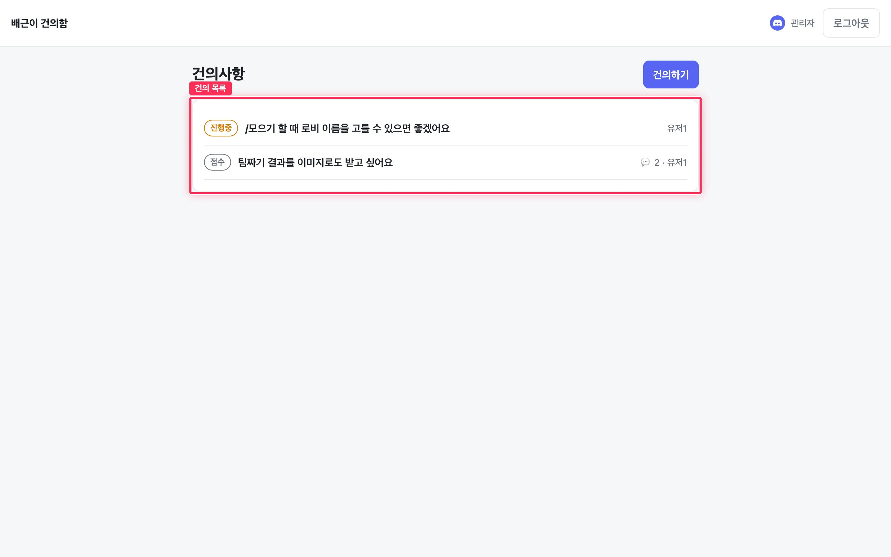
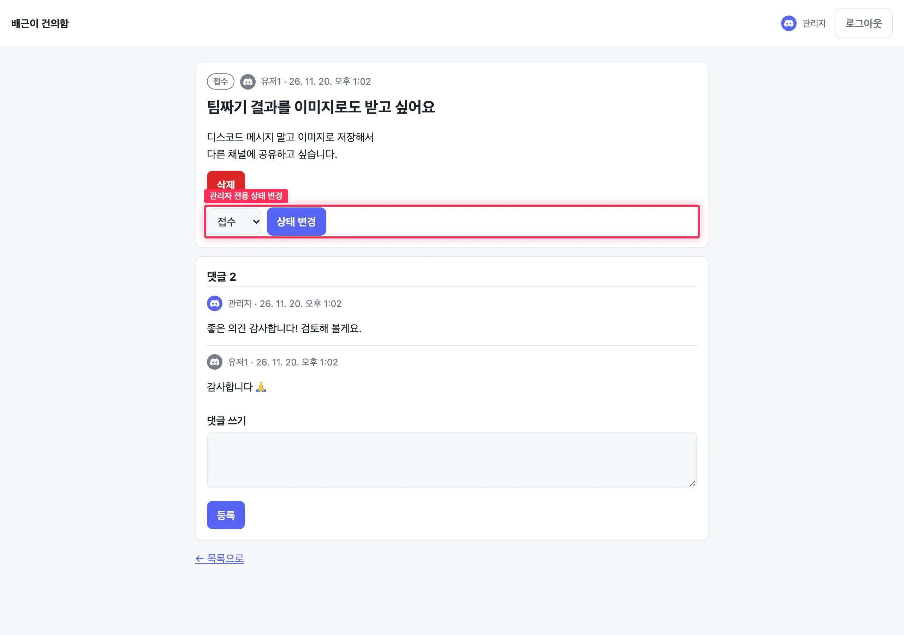
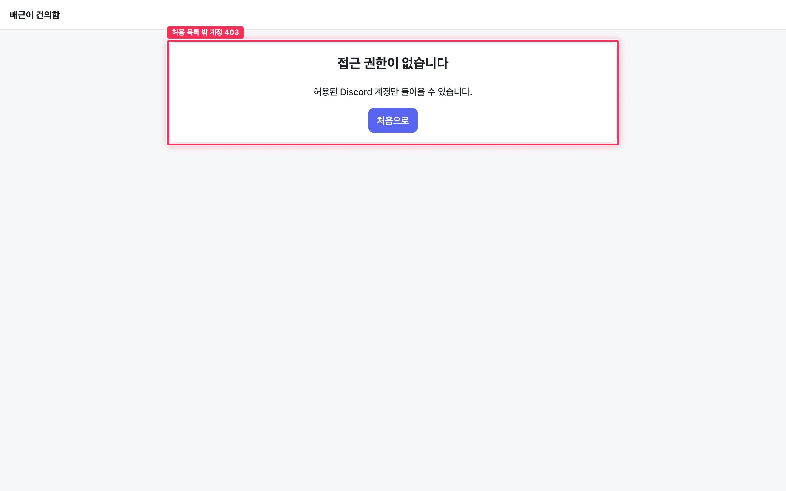

## 작업 요약

`compose.yml` 에 `web` 서비스(`dist/web/main.js`)를 추가했다. Discord OAuth2(`identify`)로 로그인하고, `ALLOWED_IDS`·`ADMIN_ID` 에 있는 계정만 들어오는 건의 게시판이다.
글·댓글·처리 상태를 지원하고, 새 글과 댓글이 올라오면 관리자에게 DM이 간다. 의존성은 새로 추가하지 않았다 (Node 내장 `http` + 기존 `better-sqlite3`).

## 변경 전후

| 전 | 후 |
| --- | --- |
| [site.txt](https://raw.githubusercontent.com/gyeolhwi/team-splitter/main/.issue/33/evidence/before/site.txt) — `team-splitter.hwiii.com` 접속 시 TLS 실패, `src/web` 없음 |  |
| (게시판 없음) |  |
| (게시판 없음) |  |

새 기능이라 before 화면이 없어서, before는 도메인 접속 실패 기록(텍스트)으로 남겼다. after는 로컬(`localhost`)에서 서명 쿠키로 찍었고, 빨간 박스가 각 화면의 핵심 구간이다.

## 변경 파일

- `src/web/server.ts` — 라우팅, OAuth 콜백(state 쿠키 검증), 권한 검사, 폼 32KB 제한, CSP 헤더
- `src/web/auth.ts` — HMAC 서명 세션 쿠키(7일), 세션에서 파생한 CSRF 토큰, 허용·관리자 판정
- `src/web/board-store.ts` — posts/comments (`data/board.db`, 봇 DB와 분리)
- `src/web/html.ts` — 서버 렌더링 템플릿, 모든 출력 이스케이프, 다크모드 대응
- `src/web/notify.ts` — 봇 토큰으로 Discord REST를 불러 DM 발송. 실패해도 글 저장은 그대로
- `src/web/main.ts` — 환경변수 검증 후 서버 시작
- `compose.yml`, `.env.example`, `package.json`(`dev:web`), `docs/deploy.md`(8절)

## 검증

- `npm run typecheck` / `npm run build` 통과
- `npm test` 89개 통과 (신규 `tests/web.test.ts` 13개: 위조·만료 세션 거부, 비허용 403, state 불일치 거부, CSRF 누락 차단, 상태 변경·수정·삭제 권한, 이스케이프, DM)
- 원본: [test.txt](https://raw.githubusercontent.com/gyeolhwi/team-splitter/main/.issue/33/evidence/after/test.txt)

## 남은 이슈

- 배포가 남아 있다: Portal Redirect URL 등록, 서버 `.env` 입력, Caddy 블록 추가 (`docs/deploy.md` 8절). 그 뒤 실제 도메인에서 로그인을 끝까지 확인한다
- `docker compose config` 검증은 로컬에 docker가 없어 서버에서 한다
- 댓글 삭제는 요구사항에 없어서 넣지 않았다
