## 후속 수정 2 — 상세 오른쪽 정보 패널, 상태 4칸 버튼, 목록 상태 탭

- 상세: 본문은 왼쪽, 상태·작성자·작성일·수정·삭제는 오른쪽 패널에 둔다. 모바일은 제목 → 상태 → 작성자·작성일 → 본문 → 수정·삭제 → 댓글 순서다
- 상태: 관리자는 4칸 버튼(접수·진행중·완료·반려)을 누르면 바로 저장된다. 선택 상자, 스크립트, CSP `script-src` 예외를 모두 없앴다(CSP는 다시 스크립트 전면 차단). 키보드 방향키로 연속 저장되던 문제도 함께 사라졌다
- 목록: 위에 전체·접수·진행중·완료·반려 탭과 개수를 두고, 누르면 `?status=` 로 거른다

| 화면 | 전 | 후 |
| --- | --- | --- |
| 상세 1280 라이트(관리자) | 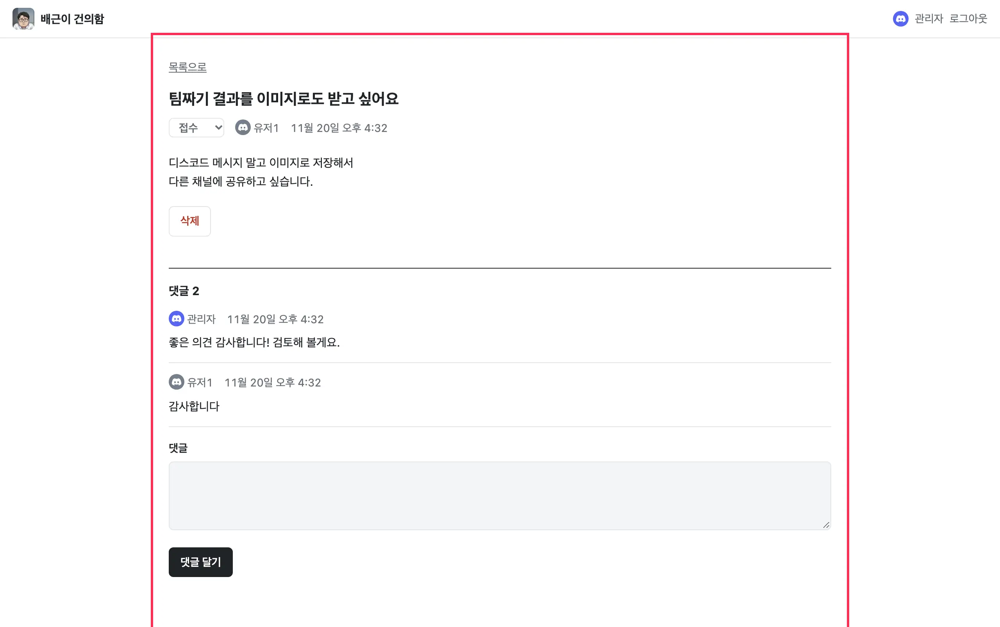 | 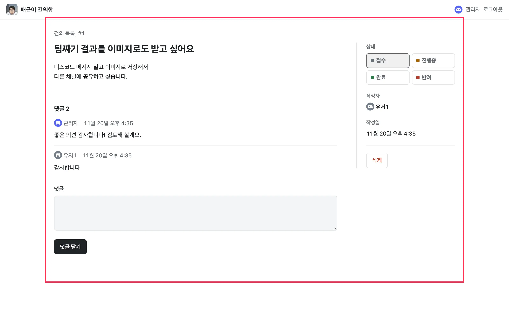 |
| 상세 390 라이트(관리자) | 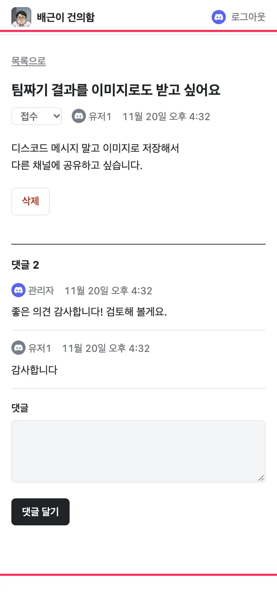 | 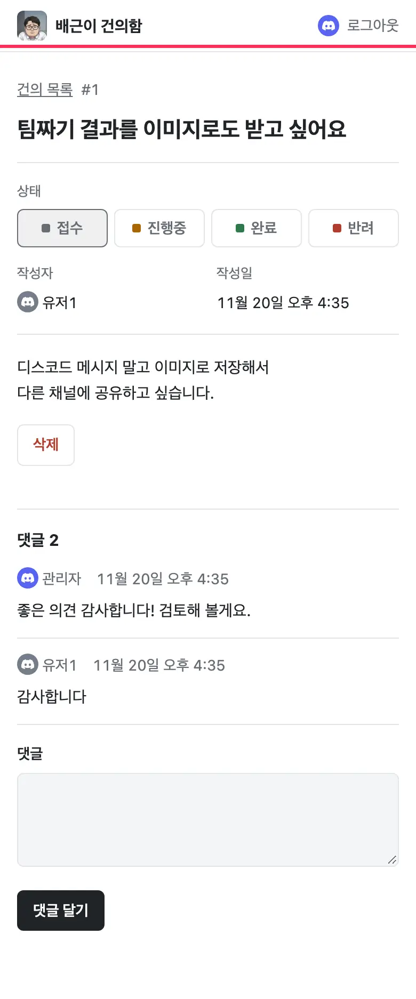 |
| 목록 1280 라이트 | 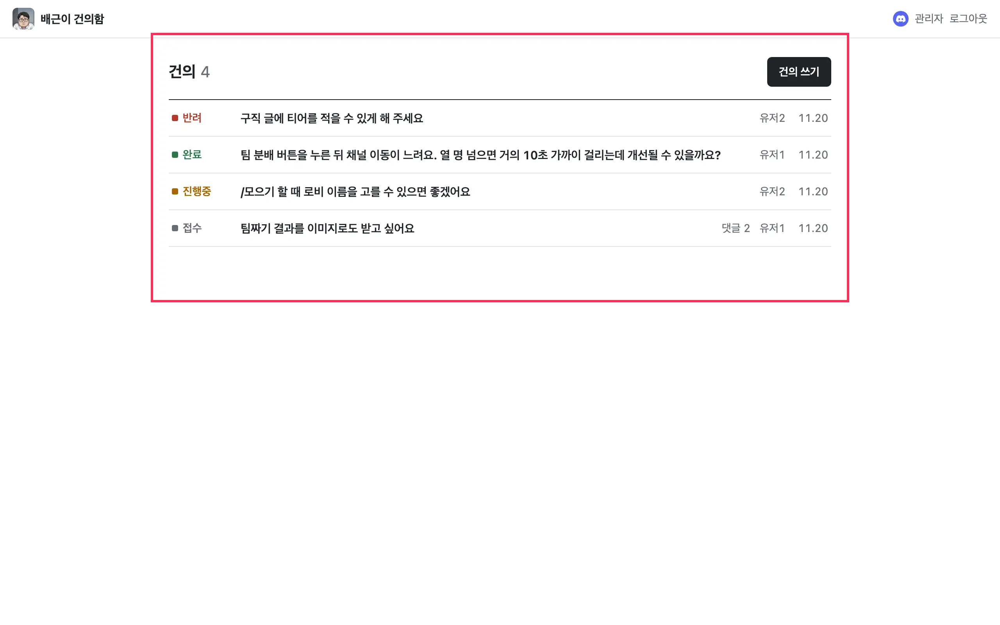 | 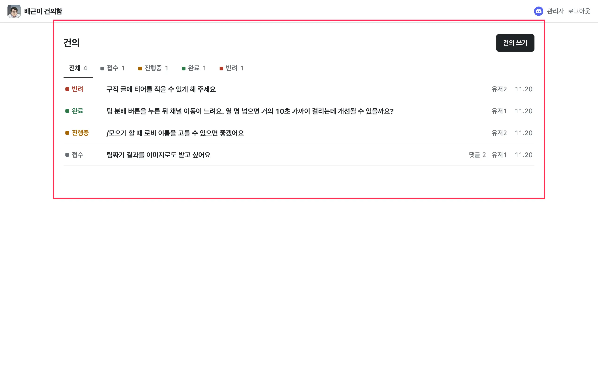 |
| 목록 390 다크 | 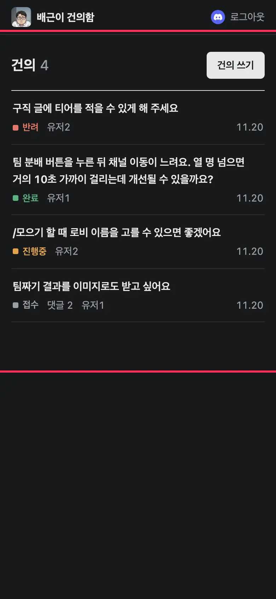 | 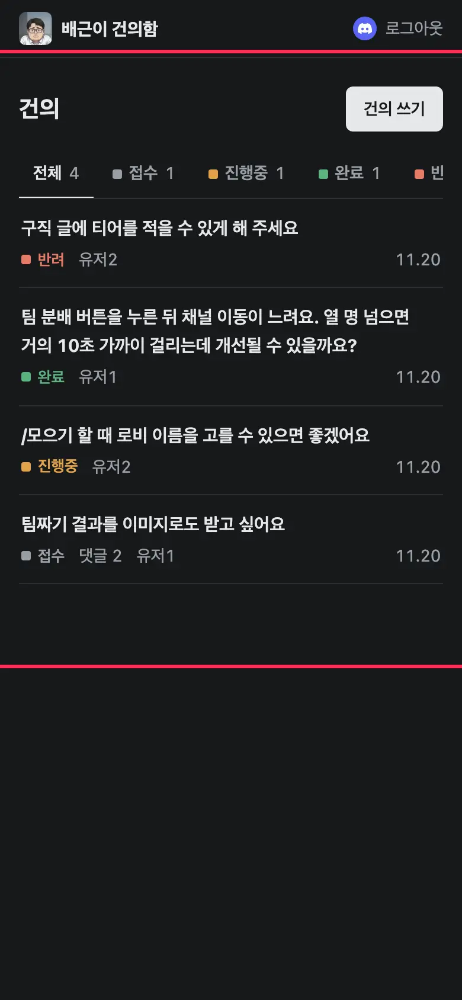 |

나머지 4쌍

| 화면 | 전 | 후 |
| --- | --- | --- |
| detail-desktop-dark | 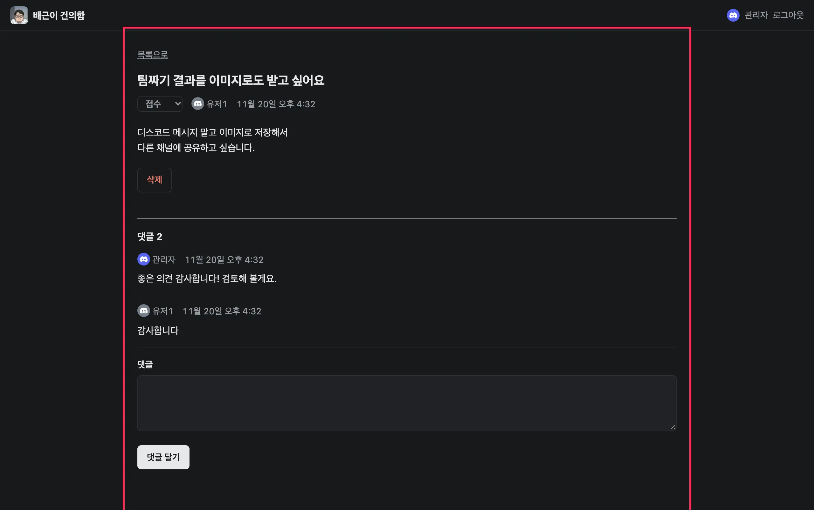 | 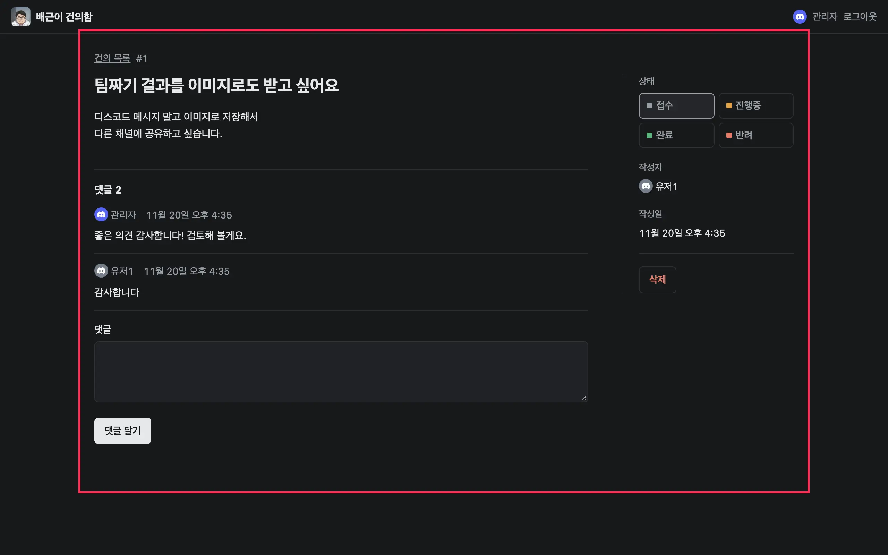 |
| detail-mobile-dark | 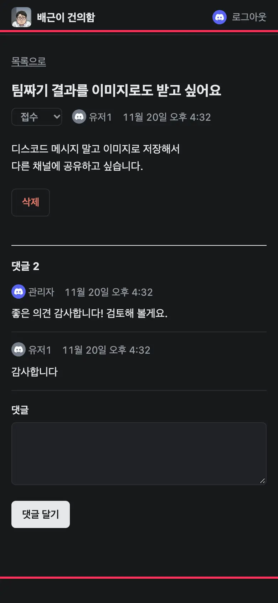 | 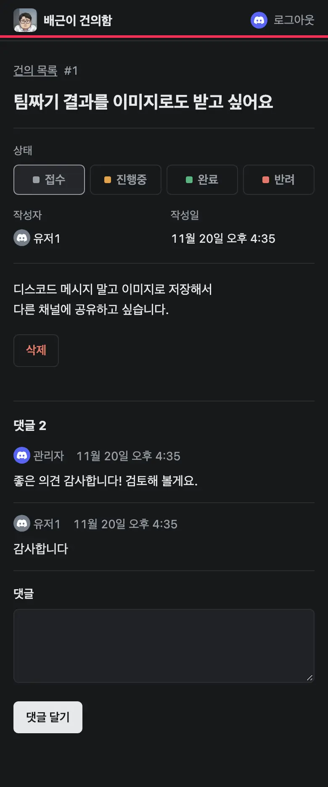 |
| list-desktop-dark | 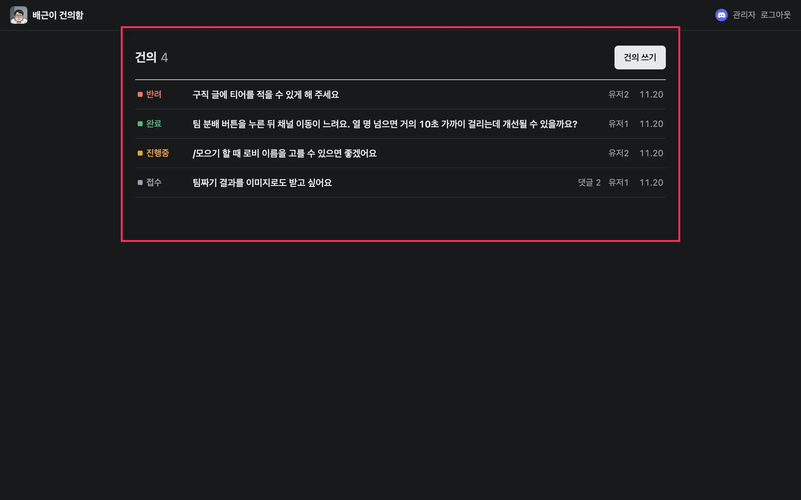 | 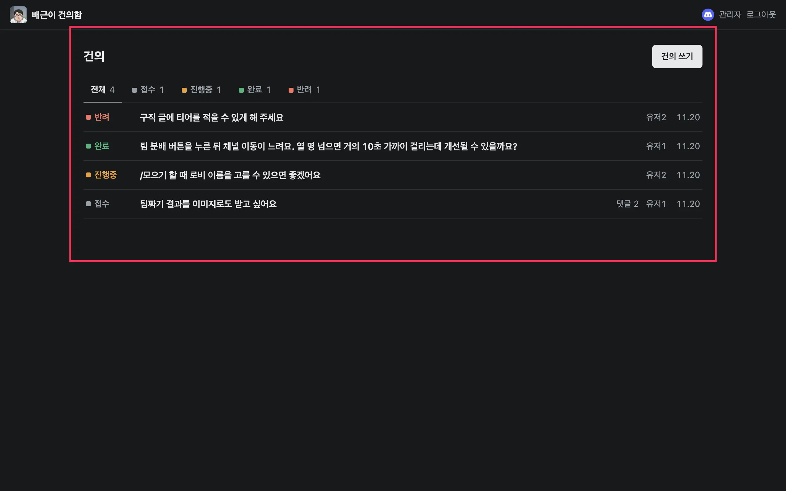 |
| list-mobile-light | 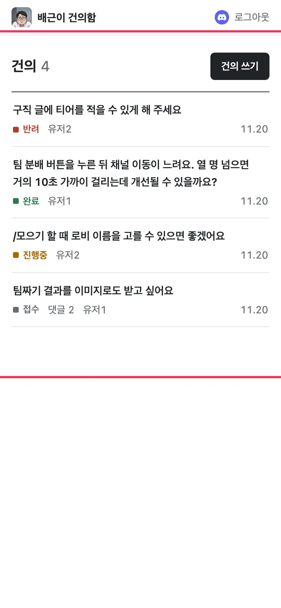 | 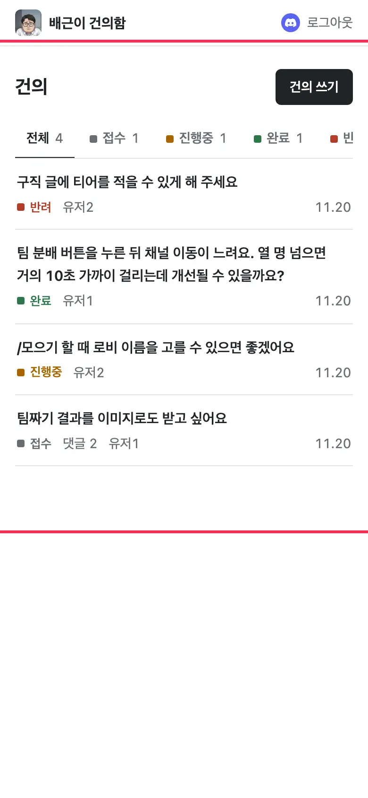 |

## 검증

- `npm run typecheck` / `npm run build` 통과, `npm test` 93개 통과 (신규: 상태 버튼 4개·스크립트 없음·CSP에 script-src 없음, 상태 탭 필터와 개수·잘못된 `?status=` 무시)
- 1280·390 × 라이트·다크 캡처로 배치를 직접 확인했다
