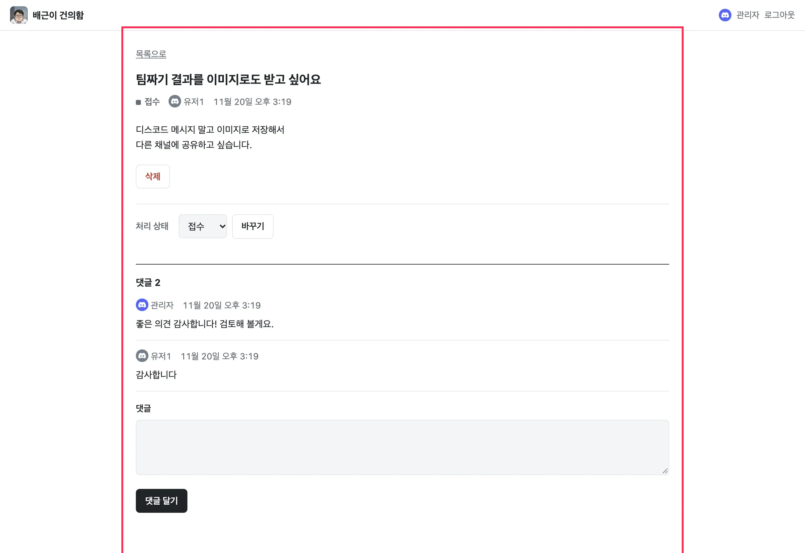
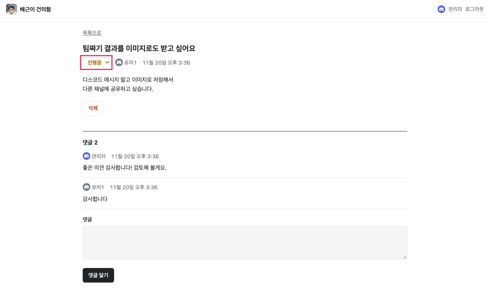
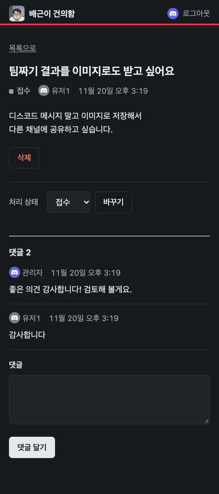
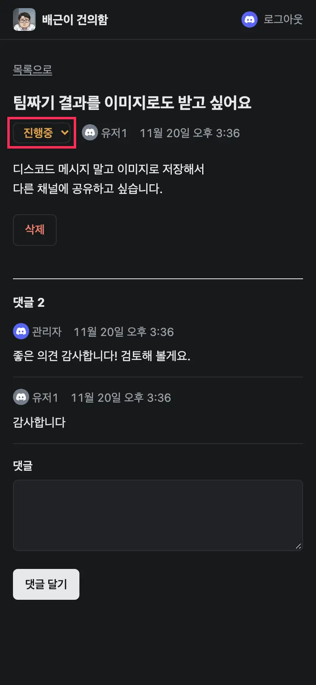

## 후속 수정 — 처리 상태 즉시 변경

관리자는 제목 아래 상태 자리에서 바로 처리 상태를 고른다. 고르는 즉시 저장되고, 아래에 따로 있던 "처리 상태" 줄과 "바꾸기" 버튼은 없앴다. JS가 꺼진 브라우저에서는 `<noscript>` 버튼이 대신 나온다.

| 화면 | 전 | 후 |
| --- | --- | --- |
| 상세 1280 라이트(관리자) |  |  |
| 상세 390 다크(관리자) |  |  |

빨간 테두리가 상태 선택 위치다. 1280 다크와 390 라이트 캡처는 `.issue/35/evidence/status-after/` 에 있다.

## 보안

CSP는 계속 `default-src 'none'` 이다. 스크립트는 상태 선택 한 줄(`STATUS_SCRIPT`)의 sha256 해시만 허용하고, 그 밖의 인라인 스크립트와 외부 스크립트는 막는다. 이 스크립트는 관리자 화면에만 들어간다.

## 검증

- 브라우저(Playwright): 관리자가 선택을 `진행중` 으로 바꾸자 페이지가 다시 로드되며 값이 저장됨. 일반 사용자 화면에는 선택 상자 0개와 상태 표시만 나옴. 콘솔 오류(CSP 위반 포함) 없음
- `npm run typecheck` / `npm run build` 통과, `npm test` 92개 통과 (신규: 스크립트 해시와 CSP 일치)
- 참고: 첫 실행에서 기존 테스트 "Discord 가 오류로 돌려보내면…" 이 1회 실패했고, 이후 전체 5회와 게시판 테스트 15회에서는 재현되지 않았다. 원인은 밝히지 못했다
